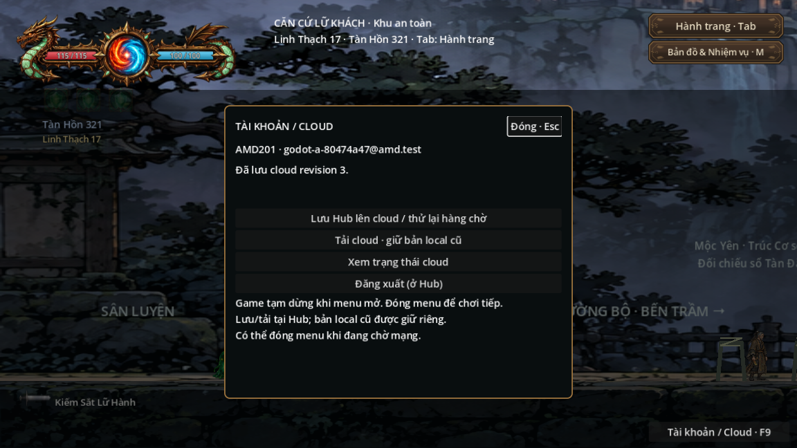
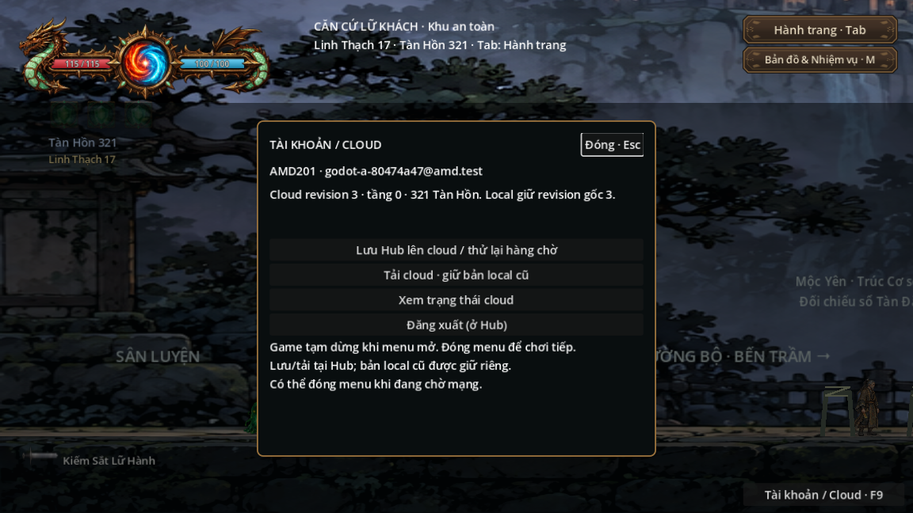
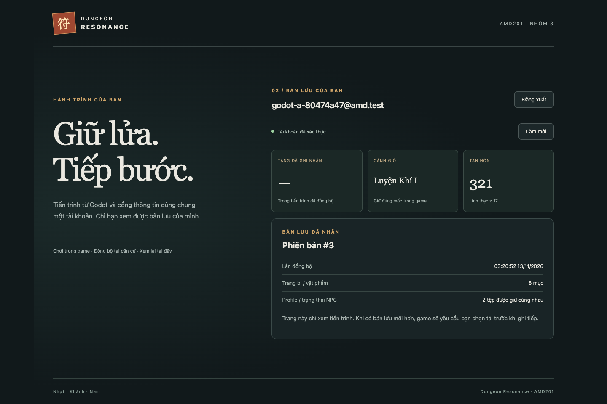
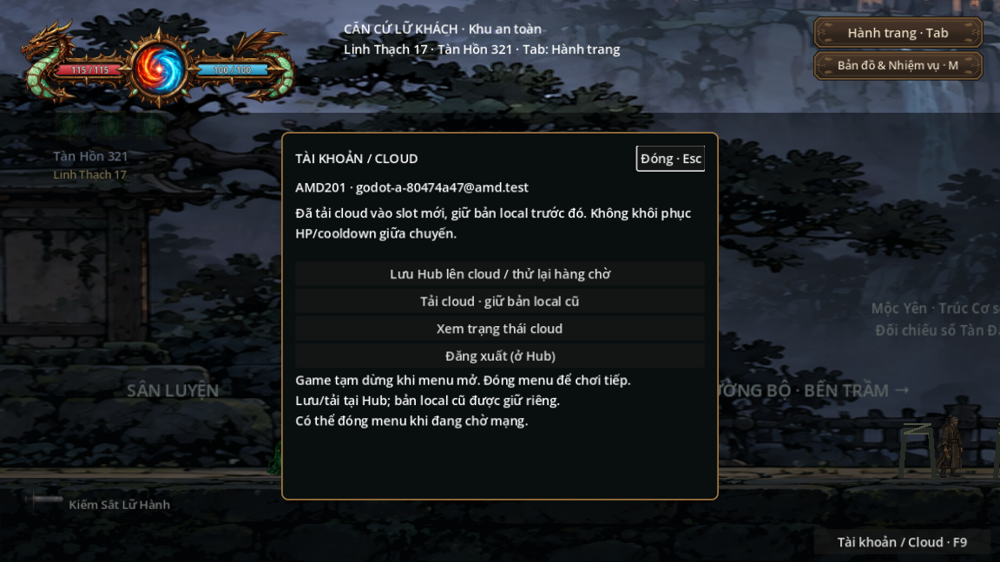
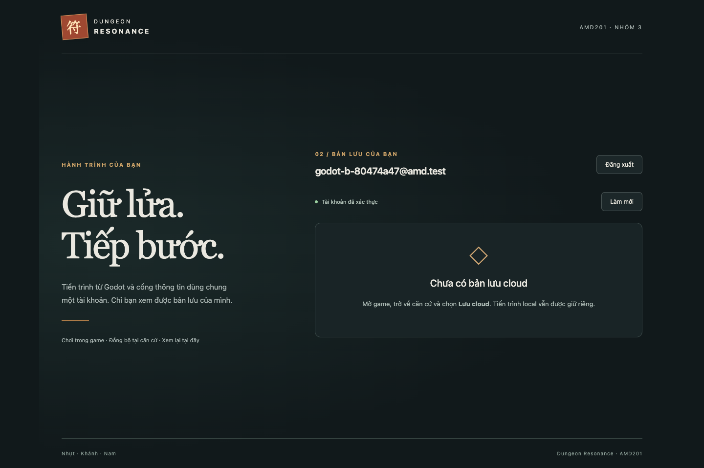
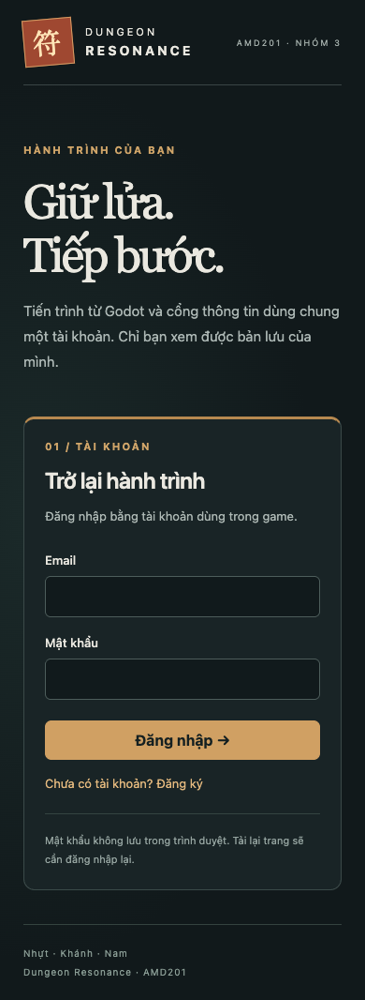

# Điểm nổi bật AMD201 và ảnh demo thật trên Mac

Mốc kiểm: **13/11/2026**, source `9d82d48`, nhánh `review/amd201-20261105`. Ảnh dưới đây là cửa sổ native Godot và React chạy thật qua HTTP API loopback, không phải mockup. Dữ liệu tài khoản A/B, 321 Tàn Hồn và 17 Linh Thạch là **fixture synthetic QA**, không phải tài nguyên kiếm tự nhiên. Không đưa mật khẩu, token hay save cá nhân vào ảnh/repo.

## 1. Ưu tiên đúng phần môn học

Trình diễn chuỗi **Godot → HTTP REST → ASP.NET Core API → database → React** trước khi giới thiệu combat. Game là client thứ hai giúp thể hiện dữ liệu dùng chung, không thay thế yêu cầu hệ thống web.

- Week 02 Slides trang 19 / Handout trang 10: ASP.NET Core Web API, React/Vue SPA, database quan hệ, REST, unit test, Docker, Actions và deployment.
- **Week 03 trang 12 nêu SQL Server/PostgreSQL**, Docker build khi push main, registry và tự động triển khai PaaS. Do đó **SQLite QA hiện tại không chứng minh hoàn tất yêu cầu database cuối kỳ**. Nhận định chỉ dựa vào Week 02 hoặc proposal SQLite cũ là chưa đủ.
- Week 03 trang 13: slides nhóm, mỗi thành viên trình bày, demo chạy thật và báo cáo cá nhân ít nhất 500 từ. Cần người thật xác nhận phần việc và viết/refine nội dung cá nhân của mình; tài liệu trạng thái không thay các báo cáo đó.
- Week 08 Handout trang 6: cần bằng chứng build image/tag, container/port và HTTP/user journey thật của backend nhóm. Có Dockerfile hoặc ảnh Docker Desktop đơn lẻ không đủ.

Một API có ranh giới account/progress rõ ràng đang được dùng; không gọi các thư mục/lớp này là nhiều microservice triển khai độc lập. Chưa có bằng chứng giảng viên duyệt đề tài cụ thể.

## 2. Bộ ảnh nên dùng khi thuyết trình

### A. Game ghi tiến trình qua API

Tại Hub, tài khoản A nhận thông báo **Đã lưu cloud revision 3**. Upload chỉ được cho phép khi ở Hub an toàn. Đây là thao tác HTTP thật vào QA host SQLite, không phải Internet cloud/production.

Xem trạng thái cloud cho thấy **server revision 3 / local revision 3 / 321 Tàn Hồn**. UI không tự ghi đè cloud khi đăng nhập trên máy mới.

### B. React đọc đúng dữ liệu từ game

Cùng email A, React hiển thị **Phiên bản #3, 321 Tàn Hồn, 17 Linh Thạch**, hai tệp profile/NPC. Đây là ảnh quan trọng nhất để giải thích tích hợp frontend/backend/game. Browser QA xác nhận dữ liệu qua API, logout xóa phần hiển thị trước, reload không giữ token trong local/session storage.

### C. Khởi động lại và tải an toàn

Một tiến trình Godot mới đăng nhập A rồi tải revision 3. Test xác nhận slot active đổi sang **slot mới**, hai tệp profile/NPC cũ vẫn tồn tại, currency giữ 321/17 và reader/seal gốc chấp nhận. Ảnh chỉ ghi trạng thái; sự tồn tại slot cũ được assertion kiểm, không suy ra chỉ từ dòng UI.

### D. Tách quyền dữ liệu từng tài khoản

B đăng nhập thật nhưng nhận **Chưa có bản lưu cloud**. API lấy owner từ session, không cho client tùy ý truyền user ID để đọc A. Không dùng ảnh này thay cho toàn bộ kiểm bảo mật; policy/HTTP tests bổ sung các trường hợp ownership/revision/idempotency.

### E. Giao diện nhỏ vẫn sử dụng được

Chrome viewport 390×844 không tràn ngang. Native menu cũng được kiểm 1152×648 và 960×540; F9/Esc, focus, pause đúng world và tiếp tục HTTP đạt 41/41.

## 3. Kịch bản demo khoảng 5 phút

1. Chạy `CHAY_AMD_MAC.command`, mở web `http://127.0.0.1:5086/`. Ghi rõ đây là SQLite local QA; mỗi máy có database riêng.
2. Trong Godot đăng ký tài khoản thử bằng email/mật khẩu thử, đăng nhập. Đóng menu, di chuyển/cast ngắn rồi quay lại Hub; không cần đi hết dungeon để giải thích AMD.
3. F9 → **Lưu Hub lên cloud**. Ghi revision và currency hiện tại. Không dùng số 321/17 như mục tiêu gameplay, chúng chỉ thuộc fixture chụp ảnh.
4. React đăng nhập cùng tài khoản → so sánh revision, currency và hai tệp. Giải thích GET/PUT, session/owner và database.
5. Đóng game, mở lại, đăng nhập A → **Tải cloud**. Cho thấy tải an toàn vào slot mới. Đăng xuất và thử B để minh họa quyền riêng.
6. Trình bày kết quả kiểm tự động và danh sách chưa đạt dưới đây, không dùng ảnh cấu hình thay bằng chứng deploy.

## 4. Kiểm đã chạy trên Mac

| Kiểm | Kết quả | Phạm vi |
|---|---:|---|
| API policy/HTTP | 18 pass, 1 PG skip | SQLite test host; skip không phải pass |
| Web | 3 pass + build pass | Dependency lock; production bundle |
| Godot capsule | 38/38 | Schema, byte limits, digest, reader/seal |
| Native write / cold restore | 30/30, 11/11 | Godot → HTTP → SQLite |
| Native edge / menu | 32/32, 41/41 | Retry, corruption, stale revision, ownership, modal/input |
| Native combat | 14/14 | Đoạn campaign ngắn; không full playthrough |
| Native UI comparison | 21/21 | Bốn đoạn render 2 giây, không phải benchmark toàn game |
| Showcase / cold revision 3 | 21/21, 11/11 | Chính các trạng thái trong ảnh |
| Chrome 157.0.8103.51 | 6/6 | Cùng dữ liệu, owner B, logout/reload, mobile |

Mẫu HTTP pending 1,1 giây: Player di chuyển 329,56 px; p95 render interval 13,678 ms, max 57,678 ms. Đo combat: 6 cast, p95 physics interval 24,970 ms, max 26,804 ms; nhân vật có thể chết bình thường. Không coi frame interval physics là render FPS. Đối chứng UI ngắn có p95 current 16,011 ms, HTTP pending 13,342 ms, baseline đầu 13,804 ms và lặp 13,013 ms; một route lệch một physics step ở điểm cuối. **Không tuyên bố tối ưu nhanh hơn, toàn game mượt hoặc hết crash**. Log native còn macOS IMK mach-port diagnostic; một lần chạy native trong sandbox abort trước đăng ký NSApplication, chạy GUI được phép sau đó pass. Không xóa hoặc tính lần lỗi đó là pass.

## 5. Gate còn thiếu trước nộp cuối kỳ / sử dụng thật

- PostgreSQL synthetic thật: migration, concurrent writer, idempotency, restart và cùng luồng Godot/API/React. Production API đang dùng Npgsql; SQLite QA không thay được gate này.
- Docker image build/run, tag, port mapping và HTTP thực tế. Tránh cho API runtime dùng bootstrap/superuser; cần role ít quyền riêng.
- GitHub Actions thành công của **đúng commit**, registry image/digest, triển khai tự động PaaS, HTTPS/health và link chạy thật. Review-branch push không tự chạy `push: main` hiện tại. Không merge main hoặc bật publish/deploy flags chỉ để lấy ảnh khi chưa được phép.
- Nâng/review runtime .NET 9 trước production. Mac QA chạy với .NET 10 roll-forward không chứng minh container net9 hoặc upgrade production đã pass.
- Lecturer approval, slide nhóm và báo cáo cá nhân ≥500 từ theo phần việc thực tế. Không giả nhận góp ý/thuyết trình/peer review chưa diễn ra.
- Full opening-loop playtest, soak, save/recovery stress và đối chứng hiệu năng đủ dài. Các ảnh/ca ngắn này không là chứng nhận ổn định toàn game.

Ảnh có manifest SHA-256 tại `evidence/mac-20261113/manifest.json`. Ảnh chụp ở source 9d82d48 trước thay đổi capacity profile được tích hợp sau; không thay ảnh hoặc mô tả thành bằng chứng cho commit mới mà chưa chạy lại.
